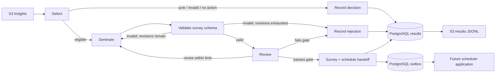

# AWS-breaking-barriers-DG37

Digital Green FarmerChat MEL Survey Agent, AWS Breaking Barriers 2026.

The [MEL Console](docs/explorer.md) generates surveys, browses saved runs, compares
configuration versions and inspects recorded decisions and question evidence. Run it
locally with Docker or deploy the authenticated console to AWS.
The [voice survey](voice/README.md) reads a survey the MEL agent wrote aloud in an
ElevenLabs voice. The farmer taps each answer, and the page builds a `response.schema.json`
record.
The [interactive architecture walkthrough](docs/architecture-walkthrough.html)
maps these extensions to the team documents and module boundaries.

- System diagram: https://aws-dg37.github.io/AWS-breaking-barriers-DG37/system-diagram.html
  (source: [docs/system-diagram.html](docs/system-diagram.html), published by GitHub Pages from `main` `/docs`)

## What runs today

The console has **Generate, Runs, Compare, Review and Configure** sections. Its FastAPI API
uses **RDS PostgreSQL** for datasets, immutable configuration versions, jobs, results
and request costs. On AWS, **CloudFront/S3** serves the UI, **API Gateway/Lambda**
serves the API, **Cognito** handles sign-in, and each job starts an **ECS Fargate** task.
Locally, the API and a polling job runner use the same graph and database.

The worker uses **Pydantic Graph / Pydantic AI** with either **Bedrock Responses
(Mantle)** or **Bedrock Converse**, selected per agent. The CLI also reads local/S3
JSONL and exports results. Accepted production surveys are written to a transactional
PostgreSQL outbox; comparisons and previews never enqueue handoffs.



This implements generation and its handoff boundary. The scheduler, delivery UI,
answer recording API, and MEL reporting applications remain separate workstreams.
The worker never sends a real message or calls production FarmerChat.

## Configuration map

| Change | File |
|---|---|
| Model IDs, reasoning effort, temperature, token budgets | `config/agent.yaml`: `generation`, `review` |
| Revision limit, relevance threshold, output retries, timeouts | `config/agent.yaml`: `graph` |
| Worker concurrency and optional token pricing | `config/agent.yaml`: `batch` |
| Survey-writing instructions | `prompts/generate.txt` |
| Model review instructions | `prompts/review.txt` |
| Improver and judge instructions (Review section) | `prompts/improve.txt`, `prompts/judge.txt` |
| Golden example provenance and held-out cases | `eval/prompt_example_split.json`, `eval/golden_holdout.jsonl` |
| Survey-or-not rules R1–R8 and their order | `src/mel/decision/__init__.py` (`build_engine`) |
| Human-call severities (R2), window policy | `config/agent.yaml`: `decision` |
| Windows, channels, caps, priority | Participant pack `json/rules/rules.json` |
| Crop-calendar evidence passed to the generator | Participant pack `data/crop_calendar_bihar_rabi.csv` |
| Actual graph topology / node routing | `src/mel/graph.py` |
| PostgreSQL layout and scheduler outbox | `migrations/` (numbered migrations) |
| AWS resources | `template.yaml` and `infra/bootstrap.yaml` |

Hosted runs use saved database configuration versions; edit, test, save and activate
them in **Configure**. YAML supplies the initial Baseline and CLI imports. Changing
YAML after a version is active does not change that active version.

All YAML paths resolve relative to that YAML file. Prefer copying the baseline
rules to a versioned config file and changing `rules_path` over editing the pack.
Unknown YAML fields fail validation rather than being silently ignored.

Environment variables use the `MEL_` prefix; see `.env.example`. There is no automatic
`.env` loading. `MEL_CONFIG_PATH` selects a config file. `MEL_BEDROCK_MODEL_ID` is
the fallback for model IDs left null in YAML, including uploaded config bundles.
Explicit generation/review YAML IDs take precedence. The SAM stack supplies the
fallback from its `BedrockModelId` parameter. For separate cloud models, set each
agent’s `model_id` and `api` (`responses` or `converse`). `BEDROCK_ALLOWED_MODEL_IDS` controls Mantle model names;
`ConverseModelIds` is the SAM parameter for Converse model/profile IDs. The console's
allowed-model list is generated from both; see
[Configure](docs/explorer.md#edit-test-and-save-a-configuration). The default model
is `openai.gpt-6-luna` in `us-east-1` for both agents.
Deployed workers use the account's `default` project; the stack creates no Bedrock
project. Local development also defaults to `default`; `MEL_BEDROCK_PROJECT_ID`
is available as an optional local override. No model ARN or project ID is needed
for deployment.

For prompt/rule changes without rebuilding the image, `bundle-config` snapshots
the YAML, prompt texts, rules, calendar, and JSON Schemas into one JSON document:

```bash
uv run mel-worker bundle-config --config config/agent.yaml --output outputs/bundle.json
```

The CLI launch script (`scripts/start_run.py`) does this automatically and uploads
the bundle under `config/`.
The worker reads it with `--bundle-uri s3://.../config/.../bundle.json`. A config
bundle is data, not executable graph code. Topology changes require a new image.
Config snapshots include no database credentials.

Prompt version `luna-golden-patterns-v7` embeds the same seven golden reference
patterns in generation and review. Positive examples span five advice types and
five crop/animal contexts, with two no-survey boundary examples. The agents are
instructed to transfer the measurement pattern rather than copy crop-specific
facts. No mustard example is included. The reviewer must quote the question and
explain its meaning before declaring a blocking defect; a Yes answer inherits
the context named in its question.

The [evaluation split](eval/README.md) divides the golden set into a 75-row dev
half, which holds these examples, and a 75-row test half. No advice text, farmer
or conversation appears in both halves. The original source
dataset is unchanged. Prompt and version edits are uploaded by each CLI launcher run
and do not require rebuilding the worker image. Console runs use their saved database
version. Use a fresh run UUID to test changed inputs or CLI configuration.

## Survey decisions and golden-set scoring

Survey or not is decided in code before any model call, by `mel.decision`. Each
golden rule is one class in `src/mel/decision/rules.py`; the engine applies them in
order and the first one that declines wins:

| Rule | Reason code | Declines when |
|---|---|---|
| R1 | `junk_insight` | `quality_flag` is junk, or the row breaks the insight schema |
| R2 | `critical_needs_human_call` | severity is in `decision.human_call_severities` |
| R3 | `nothing_to_verify` | `resolution_type` is `generic_information` |
| R4 | `waiting_for_details` | `resolution_type` is `needs_more_context` |
| R5 | `no_check_needed` | `verification.needed` is false |
| R6 | `window_after_season` | the window policy finds no window before 31 March |
| R7 | `crop_already_harvested` | the crop's calendar has ended by the advice day |
| R8 | (survey) | none of the above |

Send windows come from a `WindowPolicy`, chosen by `decision.window_policy` in
`config/agent.yaml`. The supplied golden examples and explicit pack rules disagree
on timing, so both interpretations are implemented. Digital Green has not confirmed which takes precedence:

- `golden_v1` (default, `GoldenWindowPolicy`): our timing policy inferred from the
  golden examples, not a separate policy document supplied by Digital Green.
  Day timings open at 09:00 on the first offset day and close at 19:00 on the last,
  ignoring the action window and minimum width, clipped to 31 March. `same_day`
  opens four hours after the advice for four hours, moving to 09:00 next morning
  when that falls after 19:00. Seasonal is 30 to 45 days. Settings live under
  `decision.golden_v1`.
- `pack` (`PackWindowPolicy`): the written "When to send" rules in `rules.json`:
  07:00 to 19:00, never before the action window ends, at least two days wide.

Score decisions and windows against the golden set, offline and free:

```bash
uv run mel-worker eval-rules --output outputs/eval/rules.json
```

With `golden_v1`: 150/150 decisions and rules, and 95/95 windows exact to the
minute. With `pack`: 149/150 decisions, and most window dates differ.
`tests/test_decision.py` pins the `golden_v1` result. Ask Digital Green which rule
is intended; switch in Configure or YAML. These are regression results: the rules
were developed using all 150 golden cases, including the holdout. Agreement with
the examples does not establish compliance with the pack’s written timing rules or
performance on unseen cases.

To run the real agents on held-out golden insights, extract the insights first.
Expected answers are never written to the agent input:

```bash
uv run mel-worker golden-insights --output outputs/golden_insights.jsonl
uv run mel-worker preview --input outputs/golden_insights.jsonl
uv run mel-worker eval-surveys --results outputs/local/<run-id>/results.jsonl
```

`eval-surveys` scores a results file with no model calls: decision accuracy,
questions and options per survey against the golden set, follow-up codes, reviewer
relevance, seconds and tokens per survey. It writes `survey_eval.json` beside the
results, including golden and generated questions side by side for human review.
Question meaning is not scored automatically yet.

Prompt history on held-out golden insights (all decisions correct in every run):

| Version | Rows | Options per question | Questions | Seconds per survey |
|---|---|---|---|---|
| v3 | 1–10 | 4.7 (max 6) | 2.3 | 6.0 |
| v4: short answer sets | 1–10 | 3.0 (max 3) | 2.3 | 4.3 |
| v5: main action first, two questions by default | 1–10 | 3.0 (max 3) | 2.0 | 4.9 |
| v5 | 11–30 | 3.05 (max 4) | 2.0 | 5.4 |
| v6: fixed plan and monitoring shapes | 1–30 | 2.9 (max 3) | 2.0 | 5.9 |
| v6, on Fargate | all 138 | 2.9 (max 4) | 2.0 | 7.0; 8 of 88 rejected |
| v7: fixed hold-off shape, no step lists, no "X or Y" | all 138, on Fargate | 2.9 (max 3) | 2.0 | 7.7; 5 of 88 rejected |

The v6 and v7 rows used the earlier 138-row holdout. From v9 the test half has 75
rows; compare later runs only with runs on the same split version.

Golden direct-action surveys often add "If not, what stopped you?" shown only after
a No. The survey contract has no conditional display, so v5 leaves barrier
questions out; that needs a `show_if` field from Digital Green.

Crop-calendar rows are supplied to generation as context; the scaffold does **not**
infer new phenology dates, fetch weather, or implement calendar-aware rescheduling.

## Fast local prompt iteration

Use `preview` while developing questions and review criteria. Python and artifact
files stay local; the only required AWS service is Bedrock. No Docker, PostgreSQL,
S3 upload, SAM deployment, or Fargate startup is involved.

```bash
uv sync
export MEL_AWS_REGION=us-east-1
export MEL_BEDROCK_MODEL_ID=openai.gpt-6-luna
# Uses your current AWS credentials/profile, as with aws sts get-caller-identity.
uv run mel-worker check-model
uv run mel-worker preview
```

The default input is `tests/fixtures/smoke_insights.jsonl`, limited to its first
10 rows. To try another local input or a separate experiment config:

```bash
uv run mel-worker preview --input path/to/insights.jsonl \
  --config config/agent.yaml
```

Each invocation rereads your local prompts/config, runs the same generation/review
function as the persisted batch worker, and writes a fresh UUID directory under
`outputs/local/` containing `run.json`, `bundle.json`, `results.jsonl`, and
`summary.json`. Inspect accepted surveys and rejected `candidate_survey` drafts,
edit prompts, and rerun. Previous runs are preserved so changes can be compared.
Preview IDs are run-local and its handoffs are illustrations, never enqueued.
Use `--full` only when you explicitly want every row of the selected input.

These are live Bedrock calls with AWS usage charges. Permission to call Bedrock
from the terminal's role is separate from the Fargate role. If the coding agent's
execution environment cannot reach AWS, run the command in your terminal; its
local artifacts can still be reviewed by the agent in the shared workspace.
Deploy the image for cloud integration tests after local quality checks pass.

## Local development with PostgreSQL

Requires Python 3.12 or 3.13, uv, Docker, and AWS credentials with access to your
selected Bedrock model. Verify GPT-6 Luna access in the workshop account before a
live test. Dependencies pin Pydantic AI and Graph to 1.84.1 because their
APIs evolve; upgrade both deliberately. The branch includes `uv.lock`; use `uv sync --locked` for the pinned environment.

```bash
uv sync
docker compose up -d --wait
export MEL_DATABASE_SSLMODE=disable  # Local compose only
export MEL_AWS_REGION=us-east-1
export MEL_BEDROCK_MODEL_ID=openai.gpt-6-luna

# One short access check, with no database or input dataset:
uv run mel-worker check-model

# Start with the 10-row curated smoke input.
uv run mel-worker run --input tests/fixtures/smoke_insights.jsonl \
  --output outputs/smoke-results.jsonl \
  --run-id 63b63c0a-1bfd-41dc-aa8b-0796118bc662
```

Generation uses real Bedrock calls and incurs model usage. Offline tests do not:

```bash
uv run --locked pytest -q
node --test src/mel/explorer/static/*.test.mjs
uv run ruff check src tests scripts
uv run cfn-lint template.yaml infra/bootstrap.yaml
sam validate --lint --template-file template.yaml
```

`tests/fixtures/smoke_insights.jsonl` contains the six worked scenarios from the
participant pack (spraying, irrigation, monitoring blight, expert escalation,
planning, and an information-only insight that gets no survey) plus four held-out
golden insights: a critical case (R2), a no-check case (R5), a harvested crop (R7),
and a hold-off survey. Automated worker tests use fake LLM
responses and an in-memory store; they verify contracts and workflow, not actual
question quality or Bedrock/PostgreSQL access.

CLI `preview` and `run` process only the first **10 nonblank input records** by default, including
skipped/rejected records. Add `--full` to process the entire input. This applies to
both the local worker and the Fargate launcher; there is no `--limit` CLI option.
Resume selects the same rows and never advances to the next 10. Switching to
`--full` requires a new run UUID. Revision/output retries still apply, so one
selected insight can make multiple model calls. Console jobs use their explicit
dataset selection instead: Generate initially selects 25 insights and comparisons
are limited to 50 per candidate.

```bash
# All rows, explicitly requested:
uv run mel-worker run --input docs/participant-pack/data/insights.jsonl \
  --output outputs/full-results.jsonl --full
```

For only the small offline worker tests:

```bash
uv run --locked pytest tests/test_worker.py -q
```

### Configuration versions, datasets and jobs

Runs are tied to saved **configuration versions**: the resolved config, prompts, rules,
crop calendar and schemas, stored immutably in `agent_configs`. Saving an unchanged
definition returns the existing version. One version is active; Generate uses it
by default, while comparisons require explicit version selections. Until a version
is activated, the first request activates `config/agent.yaml` (reusing its version if one was already saved).
`mel-worker run` also
saves its configuration as a version, so every run records a `config_id`.

```bash
uv run mel-worker config save --name "Shorter outcomes" --note "Three options max" --activate
uv run mel-worker config list
uv run mel-worker config activate <config_id>
```

Insight files are imported once into `datasets`/`insights` and queried by farmer,
crop, concern, resolution type, quality flag and India Standard Time day:

```bash
uv run mel-worker dataset import --input docs/participant-pack/data/insights.jsonl
uv run mel-worker dataset list
```

Long work is a row in `jobs`: `batch` (a dataset selection with one configuration
version) or `experiment` (the explorer's model comparison). The API only queues jobs;
a runner executes them, and several runners can share the queue:

```bash
uv run mel-worker jobs                      # Poll and run jobs until stopped
uv run mel-worker jobs --once               # Run what is queued, then exit
uv run mel-worker jobs --job-id <id> --resume  # Reclaim a stopped job; runs resume
```

A batch job's run ID is derived from its job ID, so a resumed job continues from the
same checkpoints. Jobs record progress, final status and the error of a failed job.

The worker bootstraps the SQL under a PostgreSQL migration lock. This MVP uses the
RDS-managed master secret to initialize and access the schema; split migration and
application database roles before a production deployment. RDS connections verify
the server certificate using the AWS RDS CA bundle embedded at image build time.

## AWS deployment

`scripts/deploy.sh` is an operator command: running it creates billable resources.
Nothing deploys merely by installing or testing the repository.

Two stacks avoid the bootstrap dependency:

1. `infra/bootstrap.yaml` creates the private, encrypted **SAM template upload
   bucket** and immutable-tag **ECR repository**.
2. The script builds/pushes the Linux AMD64 image, then uses `sam deploy --s3-bucket`
   to deploy `template.yaml`. No `sam build` is needed for ordinary ECS resources.

The main stack creates the worker, database, console UI/API and Cognito resources.
Fargate uses a public IP for outbound AWS HTTPS calls and has no inbound security
group rules. PostgreSQL is private and accepts traffic from the worker and console
API security groups. The Lambda API uses a private app subnet with a NAT gateway
for outbound access. The deployed console therefore includes NAT gateway costs.

GPT-6 Luna uses the Mantle Responses endpoint in `us-east-1`. The deployment
defaults to that region and model. Set the model by name, such as
`openai.gpt-6-luna`; no model ARN is required. SAM grants the worker
`bedrock-mantle:CreateInference` on the account's default project with a model-name
condition. The IAM policy constructs the default project's resource ARN internally;
there is no project resource, project-creation permission, or project ID to configure.
The task signs requests using its AWS role credentials; no OpenAI API key or
Bedrock bearer API key is required. The pinned Pydantic AI version uses a small
botocore/HTTPX SigV4 transport in `src/mel/bedrock.py` to call the compatible API.

Requires AWS CLI, SAM CLI and a running Docker engine. From the repository root,
use credentials for the intended AWS account. For a named profile:

```bash
export AWS_PROFILE=workshop
```

If you exported `AWS_ACCESS_KEY_ID`, `AWS_SECRET_ACCESS_KEY` and
`AWS_SESSION_TOKEN` instead, keep those values exported and clear profile selection:

```bash
unset AWS_PROFILE AWS_DEFAULT_PROFILE
```

Then deploy:

```bash
export AWS_REGION=us-east-1
export STACK_NAME=farmerchat-mel
export BEDROCK_MODEL_ID=openai.gpt-6-luna
aws sts get-caller-identity
bash scripts/deploy.sh
```

Using the same account, region and stack name updates the existing app. A different
stack name creates a separate deployment. The script builds/pushes the image,
deploys the stack, uploads the UI and participant dataset, invalidates CloudFront,
and prints `ConsoleUrl`. Python/uv are needed for local development and the optional
CLI checks below, not for `deploy.sh` itself.

Invite a user with the same credentials, region and stack environment:

```bash
bash scripts/add_console_user.sh teammate@example.org
```

Cognito emails a temporary password; the user chooses a new password at first sign-in.
There is no self sign-up. In **Generate**, click **Load participant pack** on a fresh
database to import the S3 dataset. The Baseline configuration is seeded automatically.
Custom JSONL ingestion currently uses the API or CLI; there is no file-upload button.
See [datasets and imports](docs/explorer.md#datasets-and-imports) for the API shape.

The existing `farmerchat-mel-assets` stack is reused. The main `farmerchat-mel`
stack creates the application infrastructure. SAM configures access
but cannot override workshop organization restrictions, model availability,
account eligibility, or any required provider onboarding. If inference is denied,
ask event staff to confirm access to the selected model and the account's default
project. The stack does not call `bedrock-mantle:CreateProject`.

After a failed stack creation, check the main stack's status. A stack in
`ROLLBACK_COMPLETE` cannot be updated; inspect its resources and delete/recreate
that failed main stack, or choose another `STACK_NAME`. Keep the assets stack.
The script does not automatically delete failed stacks or their resources.

After deployment, verify a small call using the account's default project from your
terminal (requires the terminal's AWS role to have inference permission too):

```bash
export MEL_AWS_REGION=us-east-1
export MEL_BEDROCK_MODEL_ID=openai.gpt-6-luna
export MEL_BEDROCK_PROJECT_ID=default
uv run mel-worker check-model
```

The model-access check is a live, billable inference request. The automated tests
use an HTTPX mock transport to verify signed request headers, project routing,
model IDs, reasoning settings, and structured responses without calling AWS.
With multiple agent models, set `BEDROCK_ALLOWED_MODEL_IDS` to their comma-separated
IDs for agents with `api: responses`. Converse is already supported with
`api: converse`; its allowed model/profile IDs come from the SAM `ConverseModelIds`
parameter. The UI displays these connections as Mantle and Converse. Both use AWS
credentials; the app applies its reasoning-effort setting only to Responses agents.

The deployment principal needs permissions to create the stack resources and pass
the ECS roles. A workshop account may impose restrictions; the templates do not
assume access to Digital Green's account. ECR image tags must be unique: the script
defaults to a UTC timestamp, or set `IMAGE_TAG` explicitly.

Upload the dataset/config and launch a task:

```bash
uv run python scripts/start_run.py --region "$AWS_REGION" --stack "$STACK_NAME" \
  --input tests/fixtures/smoke_insights.jsonl --config config/agent.yaml
```

The command prints a run UUID, task ARN, log group, and S3 results URI. It returns
after task submission; use ECS task status/container exit code and CloudWatch logs
to check completion. For the 6,999-row dataset, use
`--input docs/participant-pack/data/insights.jsonl`; it still processes just 10
rows unless you explicitly add `--full`. Concurrency is per task; account-wide
Bedrock quotas still apply.

Add `--wait` to wait for that exact Fargate task and download/print its results.
The launcher saves `outputs/<run-id>/launch.json` with the task definition, config
version, and final image/digest, plus a task-specific results file. It never reads
an existing `smoke-results.jsonl`. The wait polls for up to one hour; the task
continues running if the launcher times out. This launcher option runs locally
and needs no image rebuild. Changes to worker code still require redeployment.

## Checkpointing and interfaces

- A run UUID is tied to an input hash, resolved configuration/prompts/schemas,
  region, and implementation source hash. Changing these requires a new UUID.
- Reuse the same UUID and original files with `start_run.py --run-id UUID` to
  resume. A PostgreSQL advisory lock prevents simultaneous workers owning a run.
- Persisted accepted/skipped/rejected rows are not regenerated. Add `--retry-failed`
  to retry failed insights. An interrupted in-flight insight can incur model usage
  again; this is checkpointed processing, not exactly-once LLM invocation.
- IDs come from a database sequence, so surveys from different runs do not collide.
- Each accepted result and its `schedule_handoff` are committed in one transaction.
  The downstream scheduler consumes `survey_handoffs` where `status='pending'` and
  must implement claiming, cap enforcement, and acknowledgements itself.
- The S3 export includes all outcomes, including checkpoints from previous attempts.
  A task can finish checkpointing before its export succeeds; resume re-exports.
- Failed insights produce a nonzero exit code after exporting results. Quality
  rejections are recorded decisions, not task failures.

`survey` and `schedule_handoff` objects validate against the original pack schemas,
including referenced schemas and timestamp formats. Result records wrap these
objects with status, attempts, review, elapsed time, and token counts. These wrappers
are an internal batch contract, not FarmerChat's response contract.

Known pack differences are handled explicitly:

- `no_survey.schema.json` permits only `generic_information` and `needs_more_context`,
  so only R3 and R4 emit a `no_survey` object. Every skip records its golden `rule` and
  `reason` in the outcome until Digital Green supplies a broader contract.
- The flow-key rule uses a survey ID containing a hyphen, while the flow-key schema
  forbids hyphens. The worker normalizes the ID to underscores in `flow_key`.
- Golden v1 windows contradict the written timing rules; see "Survey decisions and
  golden-set scoring" for the two window policies.

The review score is an LLM quality gate, not proof of quality against a validated
rubric. Use the golden set to evaluate survey/no-survey decisions and MEL reviewers
to assess question quality. Persisted runs have a model-specific request ledger and
versioned prices. Console runs default to a $5 limit per run (per candidate in a
comparison); unpriced model/API/region combinations cannot launch with a budget.
Optional blended YAML token prices remain a legacy estimate, separate from that
ledger. See [run costs and budgets](docs/explorer.md#run-costs-and-budgets).

Review `issues` are blocking defects. Optional improvements go in `suggestions`
and do not veto an otherwise usable survey. The 0.8 relevance threshold and all
language/safety gates still apply. Both prompts enforce the three-question budget,
simple adoption questions, distinct options, and fixed not-applicable answers;
the MVP has no conditional question display. Rejected outcomes retain their draft
as `candidate_survey` for inspection and never emit a scheduler handoff.

`usage_complete=false` means at least one completed call returned no usable token
counts, or a call failed before accounting completed. Token counters are then only
the counts that were reported, not total billable usage. Cost estimates remain
unset. `check-model` prints the provider's raw usage object (without prompt/output
contents except the small test reply) to help diagnose missing counters.

## Team boundaries

1. Generation: `src/mel/graph.py`, `agents.py`, `decision/`, `handoff.py`, prompts, config, quality evaluation.
2. Scheduling: consume the validated handoff outbox; own clock, frequency caps, dispatch/retries.
3. Delivery: render questions and emit delivery/interaction events; do not decide validity.
4. Answer recording/reporting: validate submissions against the stored survey, persist
   partial/full answers, deduplicate, derive follow-up flags, and produce MEL reports.

Keep these interfaces separate even if they eventually share this PostgreSQL instance.

## Cleanup

Stop running tasks before deleting the main stack. Database deletion takes a final
snapshot; data and template buckets and the ECR repository are retained. Delete
retained objects/images, database snapshots, and retained resources explicitly when
the workshop is finished. RDS storage/compute, S3 versions, ECR, logs, Fargate,
public IPv4 addresses, NAT gateway, CloudFront/API/Lambda, and model calls can incur charges.

References: [OpenAI on Amazon Bedrock](https://developers.openai.com/api/docs/guides/amazon-bedrock),
[Bedrock projects in CloudFormation](https://docs.aws.amazon.com/bedrock/latest/userguide/cloudformation-projects.html),
[Pydantic Graph](https://ai.pydantic.dev/graph/),
[ECS standalone tasks](https://docs.aws.amazon.com/AmazonECS/latest/developerguide/standalone-tasks.html),
[SAM deployment](https://docs.aws.amazon.com/serverless-application-model/latest/developerguide/sam-cli-command-reference-sam-deploy.html).
- Survey question patterns: https://aws-dg37.github.io/AWS-breaking-barriers-DG37/survey-question-patterns.html
  (built from the golden set by `python3 scripts/build_question_patterns.py`; rerun it when Digital Green updates the pack)

## Branch-local evaluation reference

This branch retains `dg_agent/models.py`, `dg_agent/checks.py` and the original
pack/schema/golden tests from the standalone `bb-digital-green` reference.
`decide()` and `check_survey()` are kept as an independent regression comparator;
production decisions come from `mel.decision`. The legacy 145/150 golden score
measures eligibility only, not question quality.

```bash
uv run --locked pytest -q
uv run --locked mel-worker eval policy
```

The retained reference tests and worker both use `docs/participant-pack/`, so a
fresh checkout needs no extra ignored copy of the schemas. The original
`data/pack/` directory remains untouched. `eval policy` scores the decision engine on the
75-case test half (a regression baseline, hashes recorded) alongside the
independent all-150 reference baseline; `eval-rules` scores it on all 150. It writes a new JSON report under `outputs/eval/`, without model or
database calls. See the [evaluation guide](eval/README.md) for provenance,
denominators and timing-policy notes; generated-question quality
is explicitly unassessed in this first slice.

## Simple Bedrock chat smoke test

The earlier Streamlit app remains available for a direct Nova Lite chat test:

```bash
uv sync --locked
uv run streamlit run bedrock_app.py
```

Open <http://localhost:8501>. This older app hardcodes local AWS profile `digital-green` in
`us-west-2`, with conversation history, retry and New chat. Each response is capped
at 512 output tokens. It is independent of the `mel-worker` survey graph and is
not an HTTP frontend for the Fargate worker. Temporary AWS credentials stay outside
the repository. Its transport tests are named `tests/test_chat_transport.py` to
keep them distinct from the worker's `tests/test_bedrock.py`.
