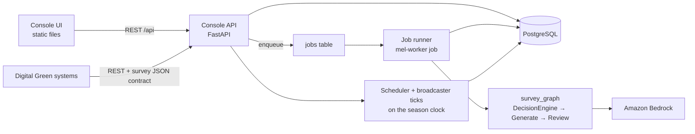

# MEL Console: whole-app plan

Status: draft for team review, 4 November 2026. Supersedes nothing yet; `architecture.md`
describes what exists today.

The MEL Console is the demo app: one web app on top of the existing pipeline. Through it,
Digital Green can:

1. **Generate** surveys from the insights dataset and inspect each one: the decision,
   draft, review, revision, and the final accepted, rejected or skipped ruling.
2. **Schedule and deliver** accepted surveys on a simulated season clock. A frequency cap
   applies per farmer. Delivery goes to a simulated phone that records tap answers.
3. **Evaluate and experiment**: score a configuration against the golden set, and compare
   configurations side by side.
4. **Give feedback and improve**: rate generated questions, and turn that feedback into
   proposed configuration changes. Later, an optimizer agent drafts those changes itself.

Experiments are one part of workspace 3. Everything shares one pipeline, one database and
one idea: a **versioned agent configuration**.

## How this maps to the vision and technical documents

| Vision requirement | Priority | Today | Plan |
| --- | --- | --- | --- |
| Insight ingestion; query by farmer, crop, topic, date | Must | Worker reads a JSONL file per run | Datasets table and a browser (Generate) |
| Survey generation agent | Must | `survey_graph` with generate, review and revise | Unchanged; run from the console |
| Survey JSON contract | Must | Pack schemas, `Contracts` | Unchanged; also exposed over REST |
| Self-evaluation before scheduling | Must | Schema check plus reviewer model in `ReviewSurvey` | Unchanged; rejects visible in Generate |
| Evaluation harness with repeated runs showing improvement | Must | `eval policy`, `eval-rules`, `eval-surveys` CLIs | Evaluate workspace, scorecards per config version, trend chart |
| Scheduler: send-window order, per-farmer cap | Must | Handoff rows in `survey_handoffs` (outbox only, no enforcement) | Scheduler that enforces `rules.json` `frequency_cap` and send hours |
| Broadcaster stub and simulated app on a simulated clock | Should | Phone `survey-player.mjs` (preview only) | Season clock, broadcaster tick, phone inbox |
| Hindi surveys (hi-IN) | Should | Supported by prompts and schema | Language toggle in preview; Hindi review in feedback |
| Latency and cost telemetry | Should | Tokens and time per outcome | Per-run and per-config cost and latency in scorecards |
| Response write-back | Exploratory | `response.schema.json` in the pack, not stored | Responses table from the simulated phone |
| Negative-outcome follow-up | Exploratory | `outcome_codes.json` in the pack | Follow-up cases created from failure outcomes |
| Invalid or low-scoring surveys not scheduled | Definition of Done | Only accepted outcomes write a handoff | Shown explicitly: the scheduler never sees rejects |

The definition of done also asks for a run over the full dataset (6,999 insights), golden
scores with at least one improvement iteration shown, and reported time per survey. The
Evaluate workspace's trend chart covers the improvement iteration directly.

## The organizing idea: agent configuration versions

Today the configuration comes from `config/agent.yaml` when a process starts. `Bundle`
already turns it into a hashed snapshot (`fingerprint`), and every run saves that snapshot
in its manifest. The plan promotes that snapshot to a first-class, versioned record.

- **An `AgentConfig` version holds every setting**: generation and review models (`model_id`,
  `api`, temperature, tokens), prompts, graph thresholds, the decision policy (rules,
  `window_policy`, human-call severities), the ruleset, and the language.
- **Versions are immutable.** Editing creates a draft child with `parent_id`, which records
  the lineage.
- **One version is active.** Production-style batch runs use it, and so the scheduler does
  too. Experiments and evaluations can use any version.
- **Every run records `config_id`.** Every score, survey and piece of feedback therefore
  traces back to the exact settings that produced it.

This replaces today's two routes, the YAML file and the experiment candidate's partial
`ModelConfig` overrides, with one. An experiment then compares N config versions on the
same insights, which allows comparing prompts and decision engines, not just models.

## Workspaces

### 1. Generate (production-style runs)
- **Dataset browser.** Import a dataset (the pack's 6,999 insights, or an upload) and filter
  by farmer, crop, topic, date, resolution type and quality flag.
- **Start a run.** Choose a dataset or filter, and a config version (active by default).
  Runs execute as background jobs and show live progress.
- **Results table.** Show accepted, skipped (with rule R1–R8), rejected (with reviewer
  issues) and failed outcomes, plus tokens and time.
- **Insight detail.** Ben's stage inspector: trace events, the drafts and revision, reviewer
  findings, and a phone preview in English and Hindi.
- **Reject queue.** All rejected and failed outcomes with reasons, so a reviewer can rate
  them (feeding workspace 4) or rerun them under another config.

### 2. Schedule and deliver
- **Season clock.** One simulated "now" for the whole app, from November to March.
  Controls: advance an hour, a day or to a date, plus manual triggers, as the technical
  document requires.
- **Scheduler tick.** Reads pending handoffs and orders them by send window and priority.
  It applies `frequency_cap` (one survey per farmer per 7 days, high priority exempt) and
  `send_hours`. Each handoff ends up `scheduled`, `deferred_by_cap` or `expired`, with a
  reason.
- **Calendar view.** Each farmer's timeline: advice, then send window, then scheduled
  slot, then delivered and answered. A cap view shows why surveys were held back.
- **Broadcaster tick.** Delivers due surveys to the simulated phone inbox. Phone rendering
  reuses `survey-player.mjs`; `channel_renderings` and `bottom_sheet` from the pack can add
  other channels later.
- **Responses.** Tapping answers writes `response.schema.json` records. Outcome codes from
  `outcome_codes.json` classify each answer as success or failure. Failures such as "did
  not work" or "crop damaged" open a follow-up case (vision journey 3).
- **MEL view.** Adoption and outcome rates per crop, topic and resolution type, from the
  simulated answers.

### 3. Evaluate and experiment
- **Scorecard per config version** on the golden holdout:
  - decisions, reasons and windows (`score_policy`);
  - survey shape, speed and cost (`score_surveys`);
  - relevance and safety from an LLM judge using a written rubric. The judge must not be
    the pipeline's own reviewer.
- **Trend chart.** Scores across config versions in lineage order: the hill-climb evidence
  the definition of done asks for.
- **Experiments.** Ben's comparison view, generalized: N config versions, the same
  insights, side-by-side questions, step traces and scores. It reruns analysis against
  saved rules or the golden reference without model calls.
- **Config editor.** The "dials": models per role, prompt text with a diff against the
  parent, thresholds, decision policy and ruleset. Save creates a draft version; "Evaluate
  draft" runs the scorecard.

### 4. Feedback and improve
- **Human feedback** on any generated question or survey: a 1–5 rating plus tags
  (irrelevant, gives advice, asks personal info, wrong timing, bad options, translation
  issue, duplicate question) and a comment. This extends `quality_assessments`, which the
  API already accepts but the UI does not collect yet.
- **Feedback inbox.** Feedback grouped by tag and by config version, with the worst
  questions first.
- **Improvement proposals.** A proposal is a draft config version plus a rationale. Version
  one is written by hand in the config editor. Later, an **optimizer agent** reads the
  feedback clusters and the current prompts and drafts the change.
- **Promotion gate.** A proposal is evaluated automatically: golden holdout scores, safety
  checks, and the questions it would change. A person approves it before it becomes active.
  Nothing is promoted automatically.
- **Leakage guard.** Feedback items and examples the optimizer adds to prompts join the
  `excluded` list of the evaluation split. The holdout then keeps measuring generalization.
  Today the decision rules were tuned on all 150 golden cases, so the holdout already
  overstates them; see `eval/README.md`.

## Architecture

- **One API.** Grow `mel.explorer` into the console API, with routers for `datasets`,
  `configs`, `runs`, `results`, `schedule`, `clock`, `deliveries`, `responses`,
  `evaluations`, `experiments`, `feedback` and `proposals`. Generation endpoints double as
  the REST contract the vision document calls for.
- **One job model.** Batch runs, experiments, evaluations and optimizer proposals become
  rows in a `jobs` table. The runner claims a job and runs it through the existing worker
  code; `run_batch` and `run_experiment` collapse into job kinds. That fixes three things in
  today's in-process approach: experiments die on API restart, at most two can run, and
  `run_batch` duplicates `run_experiment`.
- **Scheduler and broadcaster** are deterministic and cheap. They run inside the API when
  the clock advances or someone triggers them manually. A real timer such as EventBridge
  can call the same functions later.
- **The UI** stays as static files calling `/api`. Ben's survey player, stage inspector and
  comparison view carry over.

### Data model additions (new numbered migrations)

| Table | Purpose |
| --- | --- |
| `datasets`, `insights` | Imported insight sets; indexed by farmer, crop, topic, created_at |
| `agent_configs` | Immutable versions: snapshot, fingerprint, parent_id, status (draft, candidate, active, retired), note |
| `jobs` | Kind, config_id, input, status, progress, error; claimed with `FOR UPDATE SKIP LOCKED` |
| `generation_runs` | Add `config_id`, `job_id`; purpose gains `evaluation` |
| `survey_handoffs` | Statuses `pending`, `scheduled`, `deferred_by_cap`, `delivered`, `answered`, `expired`; `scheduled_for`, `reason` |
| `sim_clock` | The single simulated now |
| `responses` | Pack response contract records with outcome code |
| `follow_up_cases` | Opened from failure outcomes |
| `quality_assessments` | Extend with tags and comment for human feedback |
| `improvement_proposals` | Source feedback, draft config_id, evaluation job, decision |

## Deployment in AWS

Extend the existing SAM `template.yaml` with these pieces. The VPC, RDS, S3, ECR and
Fargate task definition already exist.

- **UI:** an S3 bucket behind CloudFront.
- **API:** Lambda running the FastAPI app unchanged (Lambda Web Adapter), behind an HTTP API
  with a Cognito JWT authorizer. Sign-in is required because the console can start paid
  Bedrock jobs. The Lambda runs in the VPC, with RDS Proxy in front of Postgres. It needs
  VPC endpoints for Secrets Manager and ECS, or a NAT gateway.
- **Jobs:** the API inserts a `jobs` row and calls ECS `RunTask` on the existing Fargate
  task definition with `mel-worker job <id>`. Long runs (the full 6,999 insights, or
  multi-config experiments) avoid Lambda's 15-minute limit. The worker role also needs
  `bedrock:InvokeModel` for Converse candidates.
- **Locally:** `docker compose` runs Postgres, the API and a runner service that polls
  `jobs`. The code paths match AWS; only the runner launch differs.

The cheaper fallback is one always-on Fargate service, about $25–30 a month whether used or
not. It needs no Lambda work but keeps the restart problem unless jobs move to `RunTask`
anyway.

## Phases

Each phase ends with something demoable. Phases 0–2 cover every Must Have.

| Phase | Delivers | Main work |
| --- | --- | --- |
| 0. Foundation (done, 4 Nov) | Config versions, jobs, datasets | Migrations; `Bundle` loads from `agent_configs`; job runner; batch and experiment become job kinds |
| 1. Generate | Full-dataset run, reject queue, previews | Generate workspace; dataset browser; reuse stage inspector and phone player |
| 2. Evaluate | Scorecards, trend, LLM judge, config editor | Wire `score_policy` and `score_surveys` to jobs; judge rubric; versions UI |
| 3. Schedule and deliver | Season clock, cap, phone inbox, responses | Scheduler and broadcaster ticks; calendar view; response write-back |
| 4. Feedback | Ratings and tags, inbox, manual proposals | Feedback UI; proposal flow with promotion gate |
| 5. AWS | Hosted console | CloudFront, Lambda, Cognito, RDS Proxy, `RunTask` dispatch |
| 6. Self-improving | Optimizer agent drafts proposals | Optimizer prompt and loop; leakage guard; proposal review UI |

Phases 3 and 4 depend only on phase 0, so two people can build them in parallel once the
foundation lands.

## Decisions for the team

1. **Timeline.** Which phases must be ready for the demo date? That sets how far to go
   beyond phase 3.
2. **UI technology.** Keep Ben's no-build JavaScript modules, which reuse what exists but
   get harder as forms, diffs and charts pile up, or move to React with Vite? Streamlit is
   too limited for the stage inspector and phone player.
3. **Hosting.** Lambda plus Fargate jobs (recommended), or a single Fargate service for
   speed.
4. **Golden-set hygiene.** Re-split so the holdout excludes the cases used to tune the
   decision rules, or accept the current split and report it as a regression baseline.
5. **The judge rubric.** Confirm with Digital Green's MEL team whether a rubric exists. If
   not, which dimensions and wording should the LLM judge use?
6. **Who owns what.** A suggested split: foundation and jobs (one person), Generate and
   Evaluate UI (Ben, building on the explorer), Schedule, deliver and responses (one
   person).
