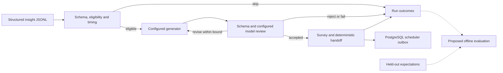

# Field Echo architecture proposal

Status: proposal for Team 37 review, 3 November 2026. Work stays on
`ben/evals-and-checks`; this does not authorize a merge into `main`.

## Problem

Field Echo turns FarmerChat conversation insights into short follow-up surveys
about advice already given. The participant brief says, “Never give new advice
and never ask for personal information” (`participant-pack/index.html:72`). It
also excludes real delivery and real farmers (`:77`). The rough team diagram is
the intended wider system; its boxes are not all implemented services.

After bringing upstream `9ad0578` into this branch, a configurable generation
worker already exists. It uses Pydantic AI/Graph, Bedrock Mantle Responses,
PostgreSQL checkpoints and a scheduler outbox, with Docker/Fargate packaging.
The architectural task is to connect trustworthy evaluation and additional input
context to that worker, rather than build another generation pipeline.

## Usage, from the caller's view

These commands exist today:

```bash
# One or a few structured insights, local artifacts, real Bedrock calls.
AWS_PROFILE=digital-green MEL_AWS_REGION=us-east-1 \
  uv run --locked mel-worker preview --input path/to/insights.jsonl

# The same graph, with PostgreSQL checkpoints and a transactional handoff.
AWS_PROFILE=digital-green MEL_AWS_REGION=us-east-1 MEL_DATABASE_SSLMODE=disable \
  uv run --locked mel-worker run --input path/to/insights.jsonl \
  --output outputs/local-results.jsonl
```

Both commands select the first three records by default; `--full` is explicit.
See [local testing](LOCAL_TESTING.md) for setup and the verified Docker path.

Proposed first addition, not implemented:

```bash
# Offline policy comparison; no model calls or deployment.
uv run mel-worker eval policy
```

Its single programmatic entry point would look like this:

```python
from pathlib import Path
from mel.bundle import Bundle
from mel.config import Settings
from mel.evaluation import score_policy

report = score_policy(
    bundle=Bundle.load(Settings()),
    golden_path=Path("eval/golden_holdout.jsonl"),
    split_path=Path("eval/prompt_example_split.json"),
)
```

A later model/prompt comparison scores recorded run artifacts. It does not build
another inference loop. A later simulator consumes accepted handoffs and writes
simulated response records, without changing generation results or dispatching
real messages.

## Shape and ownership



`preview` keeps artifacts locally and never enqueues its illustrative handoffs.
The persisted worker writes results and accepted handoffs in one transaction.
The SQL describes the outbox as “not a delivery queue implementation”
(`migrations/001_initial.sql:26`). Scheduler enforcement, delivery, response
simulation and reporting remain separate workstreams.

| Knowledge or state | Owner | Boundary |
| --- | --- | --- |
| Resolved model/prompt/rule/schema snapshot | `src/mel/bundle.py`, `config.py` | One configuration per run; secrets excluded |
| Eligibility, dates, priority and channel order | `src/mel/policy.py` | Deterministic backend policy |
| Question content and rationale | `agents.py`, `graph.py`, `models.py` | Models do not assign identity or delivery metadata |
| Official JSON contracts | `src/mel/contracts.py`, tracked pack schemas | Full validation after generation |
| Execution, checkpoints and accepted handoffs | `worker.py`, `store.py` | Existing preview/run paths, no third generation loop |
| Proposed evaluation and expected labels | `src/mel/evaluation/` | Offline scoring; labels never reach agents |
| Legacy regression comparator | `dg_agent`, existing tests | Historical baseline, not another production policy owner |

The public evaluation interface hides case loading, split validation, label
normalization, metric denominators and diagnostics. It exposes the resolved
`Bundle`, dataset references and report, because those determine what was tested.
It does not expose OpenAI, HTTPX, boto3 or graph-node objects to callers.

The generator and reviewer have separate model IDs, reasoning settings and token
budgets in `config/agent.yaml`. Null IDs use `MEL_BEDROCK_MODEL_ID`. An explicit
model override can affect both roles; comparisons must record both resolved IDs
and keep the reviewer model/prompt fixed when claiming a generator-only change.
Unsupported model/settings combinations fail visibly; no silent model switch.

Generation currently writes directly in `conversation_language`. A separate
English draft, translation service and translation cache are not required by the
brief. If translation is added, IDs, option values and follow-up meanings stay
stable, and the final localized artifact passes the same acceptance boundary.

## How the reference eval work folds in

The branch's original models, rules checks and tests were compared with
`~/src/bb-digital-green`; the core files matched before the integration. The
retained evaluator now reads the tracked `docs/participant-pack`, matching the
worker's assets. A fresh-checkout test verifies that ignored `data/pack` files
are not required. The original standalone copy remains untouched.

Use the existing checks as the reference foundation, with one production owner:

1. Keep `mel.policy` authoritative for runtime decisions. Keep the old
   `dg_agent.decide()` as a named regression comparator until differences are
   understood; do not introduce a third decision engine.
2. Adapt useful `check_survey()` assertions into shared configured checks. Expected
   timing/eligibility comes from `mel.policy`, not copied calculations. Structural
   validation uses `Contracts`, not a second independently maintained registry.
3. Initially run these assertions offline. Making them new runtime blocking
   gates changes acceptance behavior and needs its own reviewed step.
4. Mark the English regex and language-tag checks as limited evidence. They do
   not establish Hindi quality, absence of new advice, or an approved MEL rubric.

The existing **145/150** result is an all-150 eligibility regression. It does not
measure generated questions. The current prompts already contain seven golden
examples; the split excludes those and five related cases, leaving **138
candidate held-out records**. That split is not a semantic paraphrase detector.
The new evaluation must keep `expected` labels out of generation and report the
actual dataset hash and denominator for every score.

Always include all selected cases in overall eligibility/confusion counts,
including known policy misses. A missing reason mapping or an unimplemented rule
must not improve accuracy by removing difficult cases. Reason agreement is a
separate dimension: preserve raw expected/predicted codes, validate any proposed
equivalence, and label unresolved mappings explicitly. Golden `start/end` windows
also need deliberate adaptation to contract `not_before/not_after` fields.

Report schema/policy compliance, relevance/grounding, actual language quality,
follow-up behavior and reliability separately. A model review is an observed
heuristic. Its own prompt says, “human review is still needed”
(`prompts/review.txt:57`). Missing human/rubric evidence is `not_assessed`, never
a pass. Missing usage or role-specific prices means cost is unavailable.

## Proposed type sketch

These are design declarations, not a new runtime module. Existing `Bundle` and
worker `Outcome` remain in use; no replacement insight/survey class hierarchy is
required.

```python
from dataclasses import dataclass
from pathlib import Path
from typing import Literal
from pydantic import BaseModel, Field
from mel.bundle import Bundle

class Assessed(BaseModel):
    kind: Literal["assessed"] = "assessed"
    numerator: int = Field(ge=0)
    denominator: int = Field(gt=0)

class NotAssessed(BaseModel):
    kind: Literal["not_assessed"] = "not_assessed"
    reason: str

Measurement = Assessed | NotAssessed
# No evidence or a zero denominator produces NotAssessed, not a numeric score.

@dataclass(frozen=True)
class CaseComparison:
    golden_id: str
    expected_survey: bool
    predicted_survey: bool
    expected_reason: str | None
    predicted_reason: str | None
    rule: str

@dataclass(frozen=True)
class PolicyReport:
    source_sha256: str
    split_sha256: str
    scorer_sha256: str
    bundle_fingerprint: str
    eligibility: Measurement
    reason_agreement: Measurement
    cases: tuple[CaseComparison, ...]

def score_policy(
    *, bundle: Bundle, golden_path: Path, split_path: Path,
) -> PolicyReport:
    # Verify source/split provenance and exclusions; keep labels private.
    # Evaluate production policy, with all-case denominators and diagnostics.
    # Report the legacy comparator under its own dataset/denominator.
    raise NotImplementedError
```

Evaluation has its own fingerprint and output artifacts. Scorer edits must not
invalidate generation resume. The current generation implementation hash scans
top-level `src/mel/*.py`; use a clearly separated evaluation package and test this
boundary. Do not rely on that glob accidentally omitting future runtime code.
Once a checker affects acceptance, its version belongs in generation identity.

Malformed-row identity and provenance need a later change: preserve source line
and input hash even when no valid insight ID exists. Dependency failures remain
`failed`, not business `skipped` decisions. Infrastructure resume keeps a run ID;
a new stochastic experiment gets a new one.

## Synthesis decision

Two independent candidates compared a per-record `SurveyService` with extending
the existing run/artifact architecture. Both preferred the latter. The cross-judge
selected candidate B, 26/30 versus 21/30, for explicit assessment states,
reason-vocabulary handling and an offline policy-first slice.

Use B's run-oriented base, with A's narrow public entry point, explicit metric
denominators and row-provenance idea. Keep the worker graph, Docker/Fargate and
PostgreSQL outbox. Defer additional execution commands, configurable row-limit
changes and runtime acceptance changes. The existing first-three/explicit-full
guard stays in place.

The synthesis corrects two review overstatements: binary eligibility agreement
needs no reason crosswalk, and choosing a config file does not by itself replace
both model IDs. Reason aliases matter for reason diagnostics; model overrides or
shared null-ID fallbacks can change both resolved roles.

## Tradeoffs and alternatives

- Accept file-based scorecards to preserve local, offline iteration without a new
  database schema or service.
- Accept the legacy comparator temporarily to preserve a visible baseline;
  migrate consumers before removing it.
- Reject a new `SurveyService` now: it mostly wraps `process_insight()` while
  giving another caller responsibility for execution and provenance.
- Reject expected labels as a graph node and a second evaluator-owned inference
  loop. Evaluation observes generation; it does not influence the candidate.
- Defer a REST API, scheduler, simulator, separate translation/cache, multi-insight
  grouping and broad arbitrary-document ingestion until their workstream needs
  and contracts are agreed.

## Open decisions and risks

- Who confirms critical-case handling, crop-calendar exclusions, channel
  precedence and no-survey reason codes with Digital Green? Keep the current
  behavior and disagreements explicit until then.
- What rubric and human review establish question relevance, follow-up meaning
  and Hindi quality? Current model-review scores are insufficient evidence.
- Which input formats are actually needed beyond the current structured JSONL?
  Farmer profiles are not currently loaded; adding them requires explicit field
  precedence and provenance, rather than silently overriding insight language.
- Confirm the team's authority for tracked participant-pack distribution before
  any new publication. This proposal adds no copies or participant records.

## Next implementation step

After agreement, add the offline policy scorer over the documented holdout,
reusing the existing production policy and reference comparator, with tests for
label isolation, provenance, denominators and unresolved reason mappings. Do not
change generation acceptance or deploy AWS resources in that first slice.
