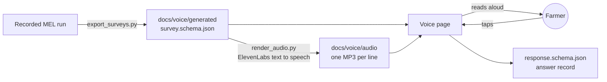

# Voice survey (ElevenLabs)

The voice page reads each survey question and its choices aloud, and the farmer taps the
answer on screen. The farmer never speaks. If there is no tap within 8 seconds after a
question ends, the question plays once more, then the page waits. This is the vision
document's "Alternative channels" item: the same survey JSON, delivered by voice. It runs on
the web only.

- Page: [`docs/voice/index.html`](../docs/voice/index.html). GitHub Pages publishes it at
  `https://aws-dg37.github.io/AWS-breaking-barriers-DG37/voice/` after merge to `main`.
- Surveys the MEL agent wrote: [`docs/voice/generated/`](../docs/voice/generated/), made by
  [`export_surveys.py`](export_surveys.py).
- Recorded speech: [`docs/voice/audio/`](../docs/voice/audio/), made by
  [`render_audio.py`](render_audio.py).

## How it works



1. `export_surveys.py` copies the surveys the MEL agent accepted in a recorded run, with the
   model, config version, run and insight that made them.
2. `render_audio.py` records each spoken line once with ElevenLabs: the opening, every
   question with its choices, and both closings. A clip is named after a hash of its
   language and text, so a changed question gets a new clip.
3. The page plays those files. It needs no API key, no microphone and no live service.
4. A tap stops the voice and records the answer as `sheet_tap`. **Next** reads the next
   question. **Finish** plays the closing, or the follow-up closing when an answer means the
   advice failed.

The repeat rule comes from the participant pack's voice channel
(`render/*/voice.json`: `timeout_seconds: 8`, `repeat_if_no_input: 1`). Change it in
`REPEAT` in [`docs/voice/survey-session.mjs`](../docs/voice/survey-session.mjs). That file
holds all survey logic and the spoken wording. It has no DOM code, so
`tests/test_voice_session.py` runs it in Node.

## Add or change surveys

The API key is never in this repository. Get it from the person who owns the ElevenLabs
workspace, then:

```bash
export ELEVENLABS_API_KEY="$(cat ~/.secrets/elevenlabs-dg37-key)"
```

1. Export the surveys from a recorded run of the MEL Console.

   ```bash
   uv run python voice/export_surveys.py --run src/mel/explorer/demo/recorded-run.json
   ```

2. Record the new lines. Lines that already have a clip cost nothing.

   ```bash
   uv run python voice/render_audio.py
   ```

3. Run the checks. They fail if a survey or a clip is missing or stale.

   ```bash
   uv run pytest tests/test_voice_session.py
   ```

To change the voice or the wording, edit `VOICE` in `render_audio.py` or `VOICE_LINES` in
`survey-session.mjs`, then run step 2 again.

## Run the page locally

```bash
python3 -m http.server 8737 --directory docs
```

Open `http://localhost:8737/voice/` and press **Read aloud**. Query parameters:

- `?scenario=gen:openai-luna-I-004512-S-0000000001.json` picks a survey the MEL agent wrote.
- `?scenario=3-potato-blight-wait` picks a participant-pack reference survey.
- `?lang=hi` switches a reference survey to Hindi.
- `?survey=<url>` loads any survey JSON. A survey without recordings uses the browser's own
  voice.

## Choices and limits

- **Voice:** "Mahi", a warm Indian female voice, with `eleven_multilingual_v2` for Hindi
  and English.
- **Cost:** recording all 37 current lines took about 3,000 characters, once. Playing
  them costs nothing.
- **Not built:** answers stay in the page and are not sent to a store.
