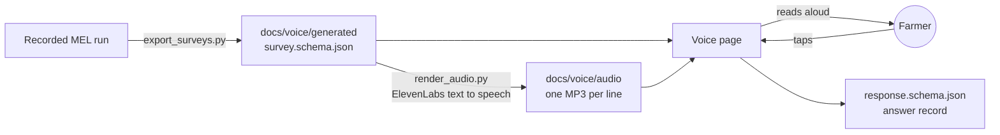
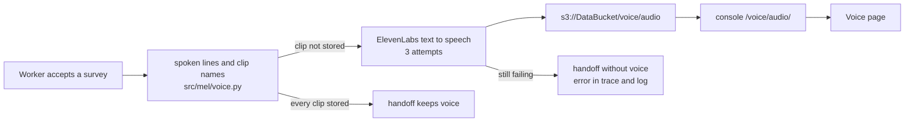

# Voice survey (ElevenLabs)

The voice page reads each survey question and its choices aloud, and the farmer taps the
answer on screen. The farmer never speaks. If there is no tap within 8 seconds after a
question ends, the question plays once more, then the page waits. This is the vision
document's "Alternative channels" item: the same survey JSON, delivered by voice. It runs on
the web only.

- Page: [`docs/voice/index.html`](../docs/voice/index.html). GitHub Pages publishes it at
  `https://aws-dg37.github.io/AWS-breaking-barriers-DG37/voice/` after merge to `main`.
- Surveys the MEL agent wrote: [`docs/voice/generated/`](../docs/voice/generated/), made by
  [`export_surveys.py`](export_surveys.py).
- Recorded speech: [`docs/voice/audio/`](../docs/voice/audio/), made by
  [`render_audio.py`](render_audio.py).

## How it works



1. `export_surveys.py` copies the surveys the MEL agent accepted in a recorded run, with the
   model, config version, run and insight that made them.
2. `render_audio.py` records each spoken line once with ElevenLabs: the opening, every
   question with its choices, and both closings. A clip is named after a hash of its
   language and text, so a changed question gets a new clip.
3. The page plays those files. It needs no API key, no microphone and no live service.
4. A tap stops the voice and records the answer as `sheet_tap`. **Next** reads the next
   question. **Finish** plays the closing, or the follow-up closing when an answer means the
   advice failed.

The repeat rule comes from the participant pack's voice channel
(`render/*/voice.json`: `timeout_seconds: 8`, `repeat_if_no_input: 1`). Change it in
`REPEAT` in [`docs/voice/survey-session.mjs`](../docs/voice/survey-session.mjs). That file
holds all survey logic and the spoken wording. It has no DOM code, so
`tests/test_voice_session.py` runs it in Node.

## Add or change surveys

The API key is never in this repository. Get it from the person who owns the ElevenLabs
workspace, then:

```bash
export ELEVENLABS_API_KEY="$(cat ~/.secrets/elevenlabs-dg37-key)"
```

1. Export the surveys from a recorded run of the MEL Console.

   ```bash
   uv run python voice/export_surveys.py --run src/mel/explorer/demo/recorded-run.json
   ```

2. Record the new lines. Lines that already have a clip cost nothing.

   ```bash
   uv run python voice/render_audio.py
   ```

3. Run the checks. They fail if a survey or a clip is missing or stale.

   ```bash
   uv run pytest tests/test_voice_session.py
   ```

### Automatic recording for the demo

On `main`, a GitHub Actions workflow
([`.github/workflows/voice-audio.yml`](../.github/workflows/voice-audio.yml)) does step 2 by
itself. It runs when a push to `main` changes a demo survey or the wording. It records
the missing clips, commits them to `docs/voice/audio`, and rebuilds GitHub Pages. To run
it by hand, open **Actions > Record voice clips > Run workflow** and keep the branch
`main`. On any other branch the job does not run.

The workflow reads the key from the repository secret `ELEVENLABS_API_KEY`. The
hackathon key expires on 2026-11-11. After that the workflow fails until you replace
the secret:

```bash
gh secret set ELEVENLABS_API_KEY --repo AWS-DG37/AWS-breaking-barriers-DG37 < key-file
```

To change the voice, edit `VOICE` in [`src/mel/voice.py`](../src/mel/voice.py). To change
the wording, edit `VOICE_LINES` in both `src/mel/voice.py` and `survey-session.mjs`:
`tests/test_voice_audio.py` fails when the two differ. Then run step 2 again.

## Hosted: the worker records each accepted survey

In the deployed stack nobody runs `render_audio.py`. When the worker accepts a survey for
the scheduler (`mel-worker run` or a console batch job), it records the survey's lines
that are not stored yet and saves each one as `s3://<DataBucket>/voice/audio/<clip>`.
A clip that is already stored costs nothing. Previews and model comparisons record
nothing, because their surveys are never scheduled.



- **No new handoff field.** `schedule_handoff.schema.json` allows no extra fields. The
  handoff already holds the survey, and a clip name is a hash of the survey's language
  and spoken text, so the page and a broadcaster compute the names themselves
  (`clipName()` in JavaScript, `clip_name()` in Python).
- **No audio, no voice channel.** If a line still fails after three attempts, or the
  key is not set, the worker removes `voice` from the handoff's `channel_order`, writes a
  `voice` trace event with the error, and logs `voice_recording_failed`. The survey still
  goes out on its other channels. A `voice` channel in a handoff means every clip exists.
- **Bounded time.** Recording runs after the survey's own time limit, with a budget of
  120 seconds per survey plus one call in progress (30 s). After that it counts as failed.
- **Play a new survey.** Open the console, sign in, then open
  `https://<console>/voice/index.html?survey=/api/runs/<run_id>/results/<insight_id>/survey`.

### Set the key

The stack creates an empty secret, `VoiceKeySecretArn` in the stack outputs. Put the key
in it once after the first deploy, and again when the key changes:

```bash
aws secretsmanager put-secret-value --secret-id "<VoiceKeySecretArn>" \
  --secret-string "$(cat ~/.secrets/elevenlabs-dg37-key)"
```

The hackathon key expires on 2026-11-11. After that, every recording fails and surveys
leave the voice channel until you put a key from your own ElevenLabs account in the
secret. The worker reads the secret at the start of each run, so no deploy is needed.

## Run the page locally

```bash
python3 -m http.server 8737 --directory docs
```

Open `http://localhost:8737/voice/` and press **Read aloud**. Query parameters:

- `?scenario=gen:openai-luna-I-004512-S-0000000001.json` picks a survey the MEL agent wrote.
- `?scenario=3-potato-blight-wait` picks a participant-pack reference survey.
- `?lang=hi` switches a reference survey to Hindi.
- `?survey=<url>` loads any survey JSON. A survey without recordings uses the browser's own
  voice.

### Switch the demo between Hindi and English

Use **English text** to translate the questions, choices, answer confirmation and
follow-up messages. Use **English audio** to hear the English wording while keeping
the screen in either language. Turn both off to return to the original Hindi survey.
Changing these controls preserves the current question, answers and follow-up codes;
the answer record retains the original survey identity and language.

The MEL Console's survey preview has the same controls and a **Read aloud** button.
Console audio uses the browser voice. The voice page prefers its recorded clips and
uses the browser voice for English lines without recordings. Voice availability and
pronunciation depend on the browser and installed voices.

English demo translations cover the two bundled MEL-agent surveys and five
participant-pack reference surveys. Other Hindi wording disables the English controls
with an explanation. These are bundled translations, not live model translation.
Add new prompt/choice translations to `src/mel/explorer/static/demo-language.mjs`, then
run `voice/export_surveys.py` to update the voice page's shared copy. Original agent
output is preserved.

## Choices and limits

- **Voice:** "Mahi", a warm Indian female voice, with `eleven_multilingual_v2` for Hindi
  and English.
- **Loudness:** ElevenLabs returns this voice at about -24 LUFS, and a page cannot play
  audio above volume 1.0. `louder()` in `src/mel/voice.py` sets every new clip to about
  -16 LUFS, with peaks below -1.5 dBTP, before it is stored. It uses the ffmpeg binary in
  the `imageio-ffmpeg` package, so no system ffmpeg is needed. `tests/test_voice_audio.py`
  fails when a committed clip is not at that loudness. Clips that the worker stored in
  S3 before this change stay quiet until you empty `s3://<DataBucket>/voice/audio/`.
- **Cost:** recording all 37 current lines took about 3,000 characters, once. Playing
  them costs nothing.
- **Not built:** answers stay in the page and are not sent to a store.
- **Changing the voice:** a clip name does not include the voice. After a change to
  `VOICE`, empty `s3://<DataBucket>/voice/audio/`, or the worker keeps the old clips.
